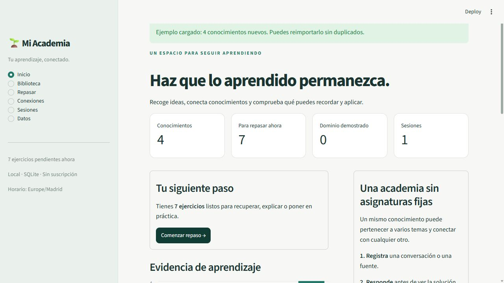

# 🌱 Mi Academia

Un sistema personal de aprendizaje continuo, local y gratuito. Guarda lo aprendido con sus fuentes, conecta ideas de cualquier área y reúne evidencia de lo que puedes recordar, explicar o aplicar.

El MVP está construido con **Python, SQLite, Streamlit, Pydantic y py-fsrs**. No requiere cuenta, claves API ni servicios de pago. Tras instalar las dependencias funciona sin conexión; los enlaces a fuentes externas necesitan conexión si los abres.



## Empezar en Windows

Probado con Python 3.12.10 en Windows. Requiere Python 3.11 o posterior.

Abre PowerShell en el proyecto:

```powershell
cd D:\Proyectos\academia
py -3 -m venv .venv
.\.venv\Scripts\python.exe -m pip install -r requirements-lock.txt
.\.venv\Scripts\python.exe -m streamlit run app.py
```

Abre [Mi Academia local](http://127.0.0.1:8501). No es necesario activar el entorno virtual. Detén la aplicación con `Ctrl+C` en su terminal.

Para las siguientes ocasiones:

```powershell
.\iniciar.ps1
```

Si PowerShell bloquea scripts, usa directamente el comando de Streamlit anterior; no necesitas cambiar la política de ejecución. El lanzador crea el entorno e instala las dependencias si faltan.

La instalación reproducible usa `requirements-lock.txt`, con las versiones verificadas. Para desarrollo con resolución de dependencias dentro de los límites de `pyproject.toml`, puedes usar `pip install -e '.[dev]'`.

## Primer recorrido

1. En **Inicio**, pulsa **Probar con una sesión de ejemplo**, o entra en **Datos → Registro rápido** para guardar tu primera idea. El ejemplo está identificado como demostración, no como conversación recuperada.
2. En **Biblioteca**, abre un conocimiento, consulta sus fuentes y, si corresponde, registra lectura o comprensión. Puedes añadir evaluaciones adaptadas al conocimiento.
3. En **Repasar**, responde antes de ver la referencia. Después autocorrige con la rúbrica, anota errores y registra el intento. FSRS programará la siguiente fecha.
4. En **Conexiones**, explora relaciones o conecta conocimientos incluso si proceden de sesiones distintas.
5. Vuelve a **Inicio** para consultar pendientes, agenda de 30 días, actividad, aciertos autónomos y estados de aprendizaje.

La aplicación arranca vacía. Los ejemplos se cargan solo cuando tú lo solicitas y se pueden importar repetidamente sin duplicar datos.

## Qué incluye

- Sesiones con identificador estable, fecha, resumen y texto original opcional.
- Conceptos, hechos, procedimientos, relaciones y competencias con múltiples fuentes, fragmentos y localizadores.
- Temas como etiquetas libres, combinables, sin lista de asignaturas ni jerarquía obligatoria. Las relaciones tienen etiquetas libres.
- Diferenciación entre conocimiento verificable, interpretación, opinión y contenido cambiante. Este último exige fecha de referencia; todos pueden tener fecha para revisar fuentes.
- Importación JSON validada, previsualización, deduplicación conservadora y transacciones completas.
- Evaluaciones de recuperación, explicación, razonamiento, comparación, análisis crítico, demostración y práctica; cada una con respuesta de referencia y rúbrica.
- Respuestas fijadas antes de mostrar la referencia, autocorrección, registro de ayuda, errores, comentarios e historial.
- FSRS real por evaluación, con estado persistente, próximas fechas y registros de auditoría.
- Búsqueda en títulos, contenido, etiquetas, fragmentos, fuentes y contexto de sesiones; filtros de tema, naturaleza y evidencia.
- Grafo de conexiones, dashboard, agenda y actividad temporal.
- Copia SQLite consistente con la aplicación abierta, restauración a un archivo nuevo, exportación completa JSON y sesiones reimportables.
- CLI para importar, validar, exportar, respaldar y consultar estadísticas.

## Registrar no equivale a dominar

| Estado | Qué significa |
| --- | --- |
| Registrado | El conocimiento se ha añadido. No se presupone lectura. |
| Leído | Has marcado expresamente que lo has leído. |
| Comprendido (declarado) | Has declarado comprensión; aún no es evidencia de ejecución. |
| En práctica | Hay intentos, pero no se cumple el criterio de dominio. |
| Dominio demostrado | Todas las evaluaciones disponibles cumplen el criterio descrito debajo. |

Para **cada evaluación**, exigimos al menos dos puntuaciones 3 o 4 sin ayuda, con una separación de al menos 24 horas entre la primera y la última; el último intento debe ser correcto sin ayuda y el recuerdo estimado por FSRS debe ser al menos del 80 %. Añadir una evaluación nueva vuelve a exigir evidencia. Un error posterior o el deterioro del recuerdo estimado pueden reducir el estado.

Es una **regla operativa del MVP**, no una certificación educativa. Depende de la calidad y cobertura de los ejercicios y de tu autocorrección. No se asigna dominio a todo un tema por acertar un solo hecho, ni se confunde probabilidad de recuerdo con comprensión. La evidencia anterior se conserva aunque cambie el estado actual.

### Puntuación y FSRS

| Puntuación manual | Descripción | Rating FSRS |
| --- | --- | --- |
| 0 | No pude responder | Again / Otra vez |
| 1 | Incorrecta o lagunas esenciales | Again / Otra vez |
| 2 | Parcial o difícil | Hard / Difícil |
| 3 | Correcta y autónoma | Good / Bien |
| 4 | Completa y fluida | Easy / Fácil |

Con ayuda se permite como máximo 2 y se usa **Again**. La aplicación no inspecciona si tu respuesta es correcta; tú aplicas la rúbrica. Las respuestas prácticas se guardan como texto, código o evidencia descrita, sin ejecutar código automáticamente.

FSRS utiliza retención objetivo del 90 %, parámetros predeterminados y aleatoriedad desactivada. Cada ejercicio tiene una tarjeta técnica independiente, aunque la experiencia incluya análisis, demostraciones y tareas prácticas. Guardamos el estado anterior, el posterior, el registro oficial, la configuración usada y la versión de la biblioteca. Las fechas se guardan en UTC y se muestran según la zona IANA configurada (por defecto `Europe/Madrid`, con cambios de horario).

La agenda es una instantánea de los ejercicios programados, no una predicción de todas tus futuras sesiones. Los pendientes de días anteriores aparecen por separado.

## Importar desde ChatGPT

**No existe acceso automático al historial privado de ChatGPT.** El flujo inicial es explícito:

1. En una conversación que quieras conservar, adjunta el [JSON Schema](docs/academia-schema-v1.json) y usa el [prompt de extracción](docs/prompt-chatgpt.md).
2. Revisa los conocimientos, las afirmaciones y los fragmentos originales. ChatGPT puede equivocarse; el validador comprueba estructura y referencias, no veracidad.
3. Guarda el JSON como UTF-8 o pégalo en **Datos → Importar sesiones**.
4. Revisa la previsualización y pulsa **Importar sesiones validadas**.

Puedes descargar el ejemplo, el esquema y el prompt desde la interfaz. El [ejemplo completo](examples/sesion.json) muestra todas las modalidades de evaluación.

El contenedor raíz usa `schema_version: 1` y una lista `sessions`. Las referencias de fuente y relaciones deben existir dentro de su sesión. `occurred_at` requiere fecha, hora y zona. Cada conocimiento necesita al menos una evidencia con fragmento o localizador. No se admiten campos de dominio ni estado FSRS procedentes de conversaciones. Los enlaces de fuente solo admiten HTTP(S), sin credenciales; no se descargan automáticamente.

### Deduplicación y conflictos

- Mismo `external_id` de sesión y mismo contenido validado: se omite sin efectos.
- Mismo `external_id` con contenido distinto: se rechaza **todo el lote**, sin escrituras parciales. Para una ampliación usa un nuevo identificador; el original queda intacto.
- Conocimiento con título y contenido normalizados idénticos, mismo tipo, naturaleza y fechas: se reutiliza y se añaden sus nuevas evidencias, temas y evaluaciones.
- Una evaluación se deduplica por conocimiento, modalidad, enunciado, referencia y rúbrica. Su estado FSRS y su historial se conservan.
- La normalización unifica mayúsculas, espacios y compatibilidad Unicode. No combina paráfrasis por significado: es preferible mantener dos candidatos a mezclar conocimientos diferentes sin revisión.

Límite de importación: 10 MB, 100 sesiones por archivo y 500 conocimientos por sesión. No se procesan directamente ZIP completos de exportación de ChatGPT: prepara sesiones con el contrato anterior.

## Almacenamiento, copias y restauración

Por defecto todo se guarda en `data/academia.sqlite3`, dentro del proyecto. No se necesita un servidor SQLite separado. Puedes elegir otra base:

```powershell
$env:ACADEMIA_DB = 'D:\MisDatos\academia.sqlite3'
.\.venv\Scripts\python.exe -m streamlit run app.py
```

En **Datos → Exportar y respaldar**, prepara las exportaciones y descarga:

- **SQLite:** copia completa restaurable, con estado FSRS, respuestas y todo el historial.
- **JSON completo:** todas las tablas para portabilidad y análisis. No es el formato del importador de sesiones.
- **JSON de sesiones:** el material original reimportable. No incluye el aprendizaje posterior ni los ejercicios/conexiones añadidos manualmente; para conservar todo usa la copia SQLite.

Una copia preparada es una instantánea; vuelve a prepararla si has realizado nuevos cambios. No copies solo el `.sqlite3` con la app abierta: puede haber escrituras en el WAL. Usa el botón de copia o el comando `backup`, que utiliza la API de respaldo de SQLite.

### CLI en PowerShell

`--db` va **antes** del subcomando. Los archivos de salida de copia/exportación deben ser nuevos.

```powershell
# Comprobar una importación sin guardar sesiones
.\.venv\Scripts\python.exe -m academia.cli import examples\sesion.json --dry-run

# Importar y consultar estadísticas
.\.venv\Scripts\python.exe -m academia.cli import examples\sesion.json
.\.venv\Scripts\python.exe -m academia.cli stats

# Guardar una copia completa; crea antes la carpeta de destino
New-Item -ItemType Directory -Force backups
.\.venv\Scripts\python.exe -m academia.cli backup backups\academia-2026-11-02.sqlite3

# Exportar todos los datos o las sesiones originales
.\.venv\Scripts\python.exe -m academia.cli export backups\completa.json
.\.venv\Scripts\python.exe -m academia.cli export-sessions backups\sesiones.json

# Restaurar en un destino nuevo, sin sobrescribir la base activa
.\.venv\Scripts\python.exe -m academia.cli --db data\restaurada.sqlite3 restore backups\academia-2026-11-02.sqlite3

# Abrir la copia restaurada
$env:ACADEMIA_DB = "$PWD\data\restaurada.sqlite3"
.\.venv\Scripts\python.exe -m streamlit run app.py
```

La restauración comprueba versión, integridad, claves foráneas, estructura y deserialización FSRS. Se niega a sobrescribir un destino existente. Puedes respaldar periódicamente a una unidad distinta. El proyecto no programa copias ni notificaciones automáticamente.

## Pruebas

```powershell
.\.venv\Scripts\python.exe -m pytest -q
.\.venv\Scripts\python.exe -m pip check
```

Las pruebas usan bases temporales, no tu biblioteca personal. Cubren validación, referencias, importaciones atómicas, idempotencia, trazabilidad al deduplicar, distintas modalidades, estados de aprendizaje, cálculo FSRS contrastado con la biblioteca, ayuda, errores, concurrencia entre pestañas, fechas y horario de verano, copias/restauración, CLI y navegación/evaluación con Streamlit AppTest. AppTest usa sockets de bucle local; un entorno que los restrinja debe permitirlos para ejecutar las pruebas de interfaz.

## Estructura del proyecto

```text
app.py                    Interfaz Streamlit
academia/models.py        Contrato de importación y huellas de deduplicación
academia/db.py            Esquema SQLite, conexiones, exportación y respaldos
academia/service.py       Casos de uso, evaluación, FSRS, consultas y estadísticas
academia/cli.py           Operaciones de datos sin interfaz
examples/sesion.json      Sesión didáctica de ejemplo
docs/                     Esquema, prompt, arquitectura y evolución
tests/                    Pruebas automatizadas
iniciar.ps1               Lanzador para Windows
requirements-lock.txt     Dependencias verificadas
```

Lee las [decisiones de arquitectura](docs/arquitectura.md) y el [plan de evolución](docs/evolucion.md) para ampliar el sistema.

Para compartir el código o consultarlo desde otro chat, consulta [GitHub y acceso desde ChatGPT](docs/github-y-chatgpt.md). El repositorio y tu biblioteca personal tienen accesos independientes.

## Alcance actual

Pensado para una persona en su equipo, accesible en `127.0.0.1`. No incorpora autenticación, sincronización entre dispositivos ni publicación en Internet. El archivo SQLite contiene tus notas en texto legible y queda fuera del control de versiones junto con las copias. Usa las protecciones y copias de tu equipo según tus necesidades.

La extracción semántica se hace con el prompt y la importación, o manualmente. No hay IA conectada, corrector automático, búsqueda remota de fuentes ni notificaciones activas. La edición de conocimientos versionados, archivado, fusiones semánticas y optimización personalizada de FSRS se dejan para iteraciones posteriores. Los datos originales y las respuestas se conservan para que esas ampliaciones sean posibles.

## Referencias técnicas

- [py-fsrs: uso, UTC y serialización](https://github.com/open-spaced-repetition/py-fsrs)
- [API de py-fsrs](https://open-spaced-repetition.github.io/py-fsrs/)
- [Streamlit AppTest](https://docs.streamlit.io/develop/api-reference/app-testing/st.testing.v1.apptest)
- [SQLite Online Backup API](https://www.sqlite.org/backup.html)
