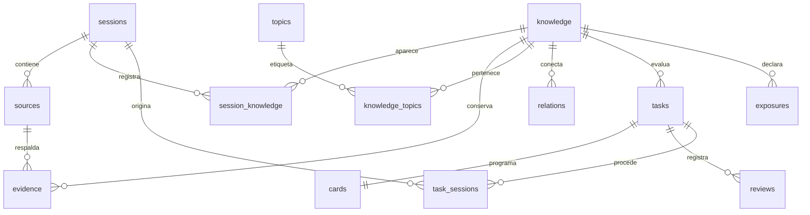

# Arquitectura y decisiones

## Una aplicación local con un núcleo reutilizable

Streamlit proporciona una interfaz con formularios, búsqueda y visualizaciones sin mantener un frontend y una API separados. SQLite evita instalar servicios. Pydantic mantiene un contrato JSON explícito. El paquete `fsrs` es la implementación Python del proyecto py-fsrs; no se aproxima FSRS con intervalos inventados.

La interfaz no contiene SQL ni calcula la programación de repasos: llama a `Academy`. La CLI reutiliza los mismos casos de uso. Una futura API puede envolver ese servicio conservando el modelo de datos. Para un MVP de una persona, añadir un servidor API, una base vectorial o una base de grafos no compensa el coste de operación.

## Modelo de datos

- **Sesión**: unidad de procedencia inmutable. Conserva el JSON validado, su huella y el texto original aportado. Una conversación no es la estructura organizativa permanente del conocimiento.
- **Conocimiento**: unidad reutilizable con tipo pedagógico, naturaleza epistemológica y contexto temporal. Los datos cambian de versión creando otra unidad, evitando alterar retrospectivamente respuestas antiguas.
- **Evidencia**: vínculo de conocimiento a una fuente concreta dentro de una sesión, con localizador y/o fragmento. La deduplicación suma evidencias sin reemplazar fuentes anteriores.
- **Tema**: etiqueta libre. Las etiquetas no constituyen un programa de asignaturas ni una lista cerrada de áreas.
- **Relación**: arista dirigida entre dos conocimientos, con etiqueta y explicación libres. Puede proceder de una sesión o de una conexión manual entre sesiones. La explicación facilita revisar por qué existe.
- **Evaluación**: enunciado, modalidad, referencia y criterios. Las importadas conservan sus sesiones de procedencia. Las añadidas desde la biblioteca se vinculan al conocimiento con sus evidencias.
- **Tarjeta FSRS**: detalle técnico por evaluación; no representa todo el conocimiento ni el tema. Permite programar también una explicación, demostración o ejercicio práctico.
- **Intento**: respuesta, nota, ayuda, errores, fecha, duración y autocorrector. Incluye el estado FSRS anterior y posterior, el registro oficial y la configuración del planificador usada. El evaluador del MVP es siempre `self`; los otros valores quedan reservados para futuras integraciones.
- **Exposición**: evento de registro, lectura o comprensión declarada; separado del historial de evaluaciones.

## Transacciones y concurrencia

Las escrituras usan claves foráneas, índices, restricciones y `BEGIN IMMEDIATE`. Importar un lote o registrar una evaluación es atómico. El WAL permite lecturas mientras se trabaja y el tiempo de espera reduce conflictos entre reruns de Streamlit.

Cada tarjeta tiene una versión. Si dos pestañas evalúan el mismo estado, el segundo intento con una versión antigua se rechaza. Un token único por intento evita duplicarlo si se repite la operación después de guardarse. Reutilizar el token con otro contenido es un error. El cambio de tarjeta y el intento se confirman juntos.

## Estado derivado y trazabilidad

El dominio se calcula a partir de las respuestas, separación temporal, ayuda y recuerdo FSRS actual. No se guarda un booleano que quede obsoleto con el tiempo ni se importa desde ChatGPT. Leer, declarar comprensión y practicar son evidencias distintas. La regla operativa se explica en el README y la interfaz.

El recuerdo FSRS estima la recuperación del ejercicio practicado bajo las hipótesis del modelo. No certifica comprensión profunda, verdad de una afirmación ni transferencia a otros problemas. Los temas no reciben dominio por agregación automática.

El historial muestra puntuaciones y respuestas a lo largo del tiempo. El dashboard actual resume estados presentes y actividad por día; aún no reconstruye una curva histórica de dominio para cada fecha.

## Búsqueda y relaciones

El MVP busca texto normalizado en conocimientos, temas, evidencias, fuentes y resúmenes de sesiones. Se filtra sin construir SQL con entradas del usuario. Las relaciones se consultan como una lista de adyacencia y se representan con DOT escapado. Para bibliotecas personales es suficiente; SQLite FTS5, consultas por vecindarios y paginación pueden añadirse cuando el tamaño lo justifique.

Las etiquetas libres y las relaciones entre conocimientos cubren la transversalidad sin imponer un árbol. Una futura jerarquía de temas sería opcional y de muchos a muchos.

## Contratos y evolución

`PRAGMA user_version` identifica el esquema SQLite, separado del `schema_version` del formato de intercambio. Una base con versión posterior se rechaza para evitar escrituras incompatibles. Esta es la versión inicial: no hay un histórico de migraciones previas. Cualquier siguiente cambio de esquema debe incrementar versión y aportar una migración transaccional con copia previa y prueba de conservación del historial.

El JSON de sesiones es un contrato estricto. Los campos desconocidos se rechazan para que una errata no se pierda silenciosamente. Las claves JSON duplicadas y referencias ausentes se rechazan. Se permite registrar una unidad sin evaluaciones, pero no declarar dominio por ello.

Las copias utilizan `sqlite3.Connection.backup()` para incluir los cambios del WAL. La restauración crea un archivo nuevo; no reemplaza la biblioteca activa. La exportación JSON completa incluye todos los datos para futuras migraciones, pero la restauración operativa del MVP utiliza la copia SQLite.

## Límites deliberados

No hay conectores de IA, ejecución automática de ejercicios, descargas de fuentes, sincronización, gestión multiusuario ni servidores públicos. El MVP conserva suficientes datos para añadir estas capacidades sin rehacer el núcleo. Las revisiones epistemológicas y fusiones semánticas deben ser explícitas para no cambiar el significado de las evaluaciones ya realizadas.
